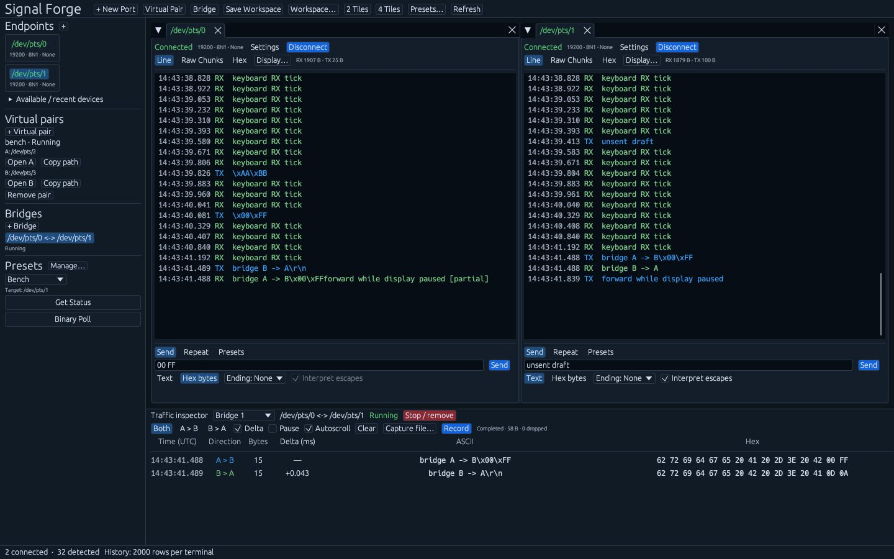
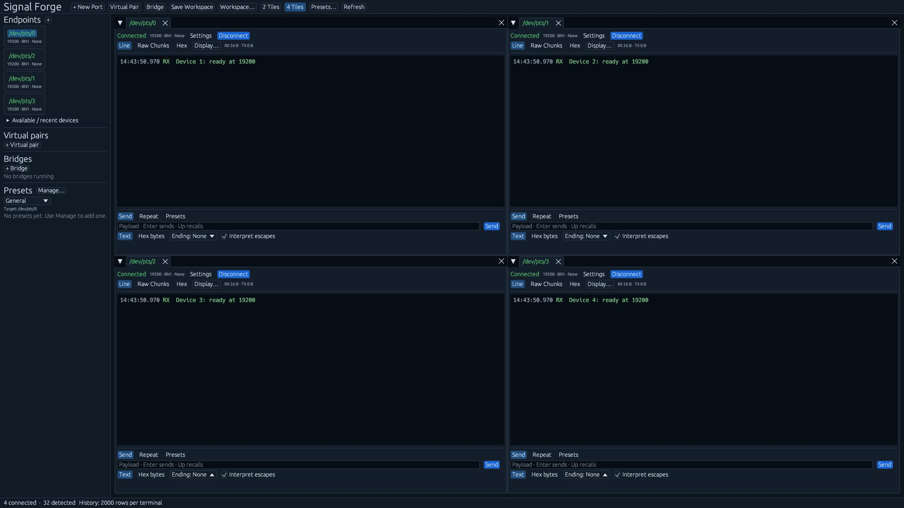
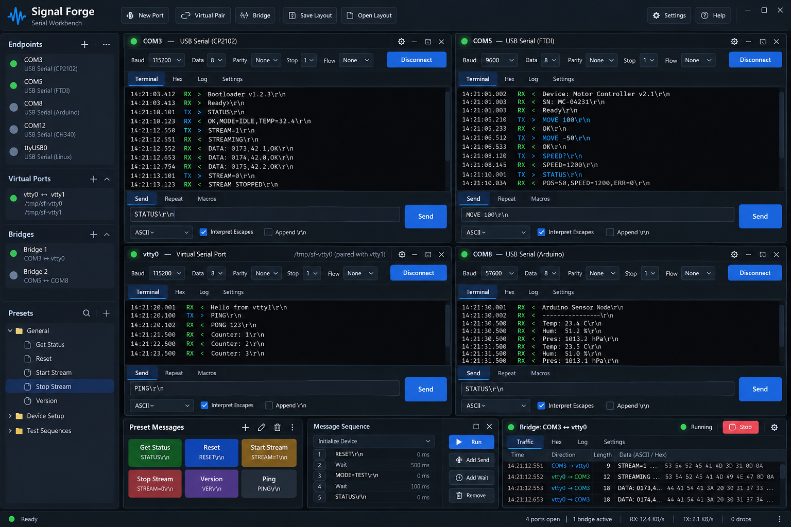
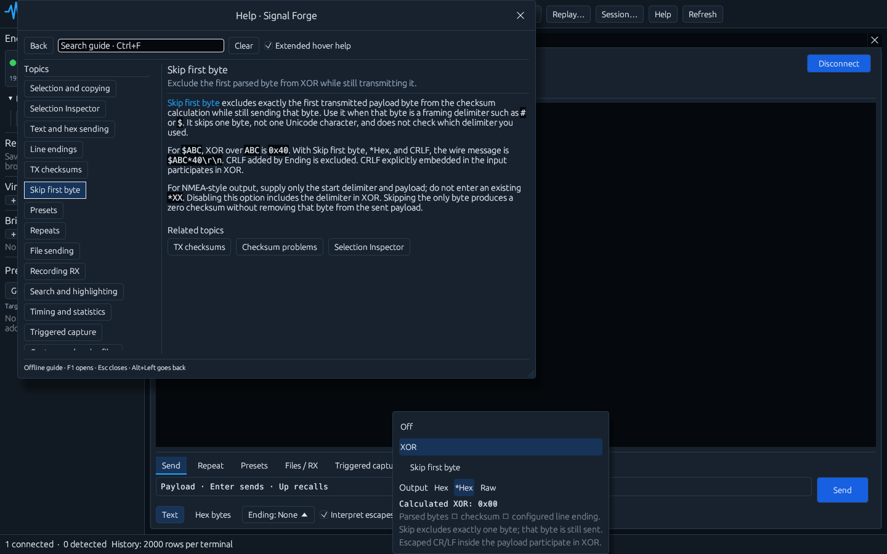

# Signal Forge

A Linux serial and network workbench implemented in Rust with egui/eframe. The app provides independently configured serial, TCP client/listener, and UDP client/listener connections, dockable terminals, validated text/hex sending, independent repeated sends, saved preset profiles, owned virtual PTY pairs, full-duplex bridges, streaming captures, and saved workspaces.

## Current implementation





## Target UI



This concept image is the design reference for the finished application. The current implementation follows its dark blue desktop shell, endpoint navigation, green connection indicators, per-pane configuration controls, black terminal surfaces, blue send/disconnect buttons, and dockable port tiles. A compact toolbar opens setup dialogs, the left sidebar navigates endpoints and presets, and the lower traffic inspector keeps bridge controls above aligned rows. Receive traffic has priority; serial settings and advanced tools expand when needed.

## Build and run on Linux

Install a current stable Rust toolchain with Cargo. On Debian/Ubuntu:

```sh
sudo apt-get install build-essential pkg-config libudev-dev libxkbcommon-dev libxkbcommon-x11-dev libwayland-dev libx11-dev libxi-dev libgl1-mesa-dev
cargo run
```

Run from a graphical X11 or Wayland session. For diagnostic logging:

```sh
RUST_LOG=signal_forge=debug cargo run
cargo test --all-targets
cargo build --release
```

The executable is `target/release/signal-forge`. To explicitly open devices at launch, pass `--port /dev/ttyUSB0 --port /dev/ttyUSB1`. Your account needs read/write access to its serial devices; on many distributions this is provided by the `dialout` or `uucp` group. The application reports permission/open errors in its status bar.

## User guide and help

Open **Help** or press **F1** for the bundled, searchable offline guide. Browse topics, follow related links, and use Back or Alt+Left to return. Esc closes the guide; reopening remembers its last topic during this session. Search matches workflow text, diagnostic terms, and stable topic IDs.

Read the [full user guide](docs/user-guide.md) for connections, terminal views, sends/checksums, files/recording, analysis, virtual pairs, bridges, SSH, workspaces, sessions, and troubleshooting. Supported controls show concise tooltips; ten seconds of continuous hover opens an explanation with **Learn more**. Dismissal lasts until the pointer leaves. Extended hover help can be disabled for this session inside the guide.



## Architecture

- `endpoint`: stable IDs, connection states, errors, transport-independent asynchronous TX interface.
- `traffic`: timestamped raw-byte RX/TX events, shared payloads, ordered nonblocking fan-out.
- `serial`: device discovery and a worker per open port; all physical I/O is outside widgets.
- `send`: pure, all-or-nothing escape/hex encoding and explicit line endings.
- `presets`: validated command/profile models, atomic persistence, and versioned JSON import/export.
- `repeat`: transport-independent scheduling, finite counts, progress, and cancellation tokens; serial workers drive timers independently of GUI repainting.
- `virtual_pair`: owned raw Linux PTYs, optional named links, and a bounded full-duplex relay.
- `bridge`: transport-neutral RX routes, serialized destination writes, lifecycle control, and independent directional monitoring.
- `inspector`: bounded display history, UTC timestamp formatting, chronological deltas, and direction filters.
- `capture`: streaming JSON Lines writer, independent bounded subscriptions, integrity summaries, and controlled shutdown.
- `config` / `workspace`: validated versioned workspace persistence, v1 migration, disconnected restoration, backup recovery, and durable atomic replacement.
- `help`: stable topic IDs, offline content from `docs/user-guide.md`, search and continuous-hover timing. `app/help_ui` owns guide navigation and contextual popup presentation.
- `app`: device controls and dock layout. `app/terminal_ui` composes separate serial-settings, display-controls, connection-status, virtualized traffic, send, repeat, and footer sections. `app/workbench_ui` owns toolbar/sidebar navigation, setup drafts, preset-library access, and live tiling. `app/theme` owns the shared navy/canvas palette, RX/TX and status colors, typography, compact spacing, and primary/danger buttons for all UI surfaces.

A slow subscriber loses monitoring events instead of blocking a serial worker. Sequence numbers expose gaps. Bridges forward through a dedicated transport RX route into the destination writer, independently of the lossy monitor bus. Independent read handles keep both RX directions active while writes are serialized. Closing a terminal stops its worker and drops its device handle; closing the application drops all terminals.

## Keyboard shortcuts

| Shortcut | Action |
| --- | --- |
| F1 / Esc in Help / Alt+Left | Open guide / close guide / previous help topic |
| Ctrl+F in Help | Focus guide search |
| Enter / Up / Down in payload | Send / recall older / return toward draft |
| Ctrl+L | Focus the selected terminal payload (outside text editing) |
| Ctrl+O | Open new-port setup (outside text editing) |
| Ctrl+Shift+S | Open workspace save/load setup (outside text editing) |
| Ctrl+Shift+O | Reconnect selected disconnected terminal |
| Ctrl+Shift+D | Disconnect selected terminal and stop its repeat/bridge |
| Ctrl+W | Close selected terminal and disconnect it |
| Ctrl+S | Save workspace |
| Ctrl+1 … Ctrl+9 | Active profile presets (outside text editing) |
| Ctrl+Shift+N / B | Open virtual-pair / bridge setup (outside text editing) |
| Ctrl+Enter / Escape in setup | Confirm port/pair/bridge setup / cancel |
| Ctrl+Shift+M / R | Pause bridge displays / toggle first bridge capture |
| Ctrl+Q | Quit, save workspace, and finish capture/cleanup |

## Self-updates

Signal Forge checks the official GitHub releases in the background at launch. The
check times out after 10 seconds; offline, current-version, and incompatible-platform
checks leave the workbench available without a prompt. Only stable Linux x86_64
releases with the expected archive and checksum are offered. **Update Now** approves
downloading, verification, replacement, and restart; **Not Now** dismisses the offer
for this session. `--no-update-check` skips the check for offline benches and automation.

The update dialog reports download progress, verification, installation, and restart.
The updater verifies the published SHA-256 before extracting only the expected regular
ELF binary, then checks its architecture and reported release version. It never runs
the archive’s installer. HTTPS requests and redirects are restricted to GitHub release
hosts. Checksums protect integrity; they do not provide independent publisher signatures.

The executable and its containing directory must support replacement. User-local
installations and writable unpacked releases can update in place; system/package-managed
or read-only installations should use their installer or package manager. Unsupported
locations report an error and keep the current app usable; the updater never requests sudo.

Installation uses an atomic rename with a synced recovery copy named
`.signal-forge-previous-*` beside the executable. Failed downloads, verification, or
replacement keep the old installation. The new process must confirm that its workbench is initialized at the expected
version within 15 seconds; failure restores and relaunches the previous binary with
a visible error and a Continue action. The recovery copy remains after a successful restart;
once satisfied with the new release, remove that copy, or use it for manual rollback.
Workspaces, presets, captures, and configuration files are not replaced. Normal shutdown
saves the workspace and finishes I/O cleanup before the new process starts. Launch
`--port` arguments are not replayed: restored terminals stay disconnected and repeats,
bridges, and captures require explicit restart. Earlier releases without the updater
need a manual install of the first release containing this feature.

## Linux package

Each passing CI run builds and uploads **signal-forge-linux-x86_64** with a release
binary, desktop launcher, eight icon sizes, installer/uninstaller, documentation, linked-library list, and SHA-256
checksum. Download it from the repository's **Actions** run, unzip the artifact,
verify `sha256sum -c *.sha256`, unpack the tarball, and run `bash install.sh`.
The default installation is `~/.local`; an optional path argument changes it. The installer creates the launcher and freedesktop hicolor icons automatically, refreshes desktop/icon caches when those utilities are available, and records its owned assets in `share/signal-forge/install-manifest.json`. Uninstall with `bash ~/.local/share/signal-forge/uninstall.sh` (use your chosen prefix for a custom install); user settings, presets, captures, and unrelated files are preserved.
You can also run the included `bin/signal-forge` directly. The package targets
Ubuntu 24.04 x86_64 or compatible newer glibc Linux with X11/Wayland and OpenGL.

Build the same package locally with `bash scripts/package-linux.sh`. Configuration
and captures are excluded from the archive. Merges to `main` automatically run the
full build/test/package pipeline and publish a GitHub Release with the archive and
checksum. Each merge increments the patch version: the first release with the new
automation is **0.1.1**, followed by **0.1.2**, **0.1.3**, and so on. Tags use
`v0.1.1`; the release title, archive name, and executable's `--version` agree.
Releases are published only after all checks pass. Rerunning a commit keeps its
version and updates the same release. Direct pushes to `main` also increment the
patch. A merge counts once regardless of the number of commits on its PR branch.

`Cargo.toml` stores the base version. CI adds the number of first-parent commits
since that base version was introduced and updates the root package in both Cargo
files for the build, without committing back to `main` or triggering another release.
Dependency edits do not reset the count. To start a new minor or major series,
explicitly update the base version in both Cargo files to a version higher than
the latest release. A full Git checkout is required for automatic versioning.
For the same version locally, run `python3 scripts/release-version.py --apply`
before packaging. PR artifacts remain available before merge for review.

## Verification

See the [manual Linux smoke checklist](docs/manual-smoke-test.md) for release and
physical-device checks. CI runs pure encoding/scheduling/history tests and real
Linux PTY flows for text/CRLF, arbitrary binary, independent endpoints, finite
repeats/cancellation, concurrent duplex bridges/backpressure, disconnect/reopen,
traffic filtering, capture integrity, and shutdown. Workspace tests cover migration,
layout/options round trips, invalid/corrupt config preservation, and atomic saves.
Xvfb GUI tests exercise presets, Enter/Up/Down, real forwarding/capture, restart
without opening or transmitting, recovery, and graceful cleanup. UI checks exercise four live panes at 1920×1080, 2560×1440, and the 900×600 minimum, narrow-pane transmission, two/four-tile rearrangement without reopening, and setup cancellation. A restarted-GUI check confirms the expected version over the private readiness channel, preserves workspace/preset data, and verifies that no serial connection or TX starts automatically. The release archive
is extracted, checksum-verified, installed into a temporary prefix, and launched
with `--help` in CI. Physical adapters and electrical flow/parity behavior require
a local bench and are not claimed as PTY test coverage.

Application icons are generated from [the canonical artwork](assets/signal-forge-source.png) with `python3 scripts/generate-icons.py`. The window embeds its icon and uses the `signal-forge` application ID to match the launcher on Linux. Self-update installs the verified release's launcher, icons, documentation and uninstall helper alongside the executable, with rollback of both executable and assets on a failed restart. Old executable-only installs acquire the embedded launcher/icons on first launch after updating. Standalone binaries outside a recognized installation do not create desktop files.

Use **Network…** to open TCP/UDP endpoints. UDP preserves packet boundaries and peer addresses; stream-to-UDP bridges default to complete LF/CRLF lines. See [Network endpoints](docs/user-guide.md#network-endpoints) and [Network bridge framing](docs/user-guide.md#network-bridge-framing). Socket and framing code is isolated in `crates/network`, with Linux and Windows CI tests; the desktop application remains Linux-only.
